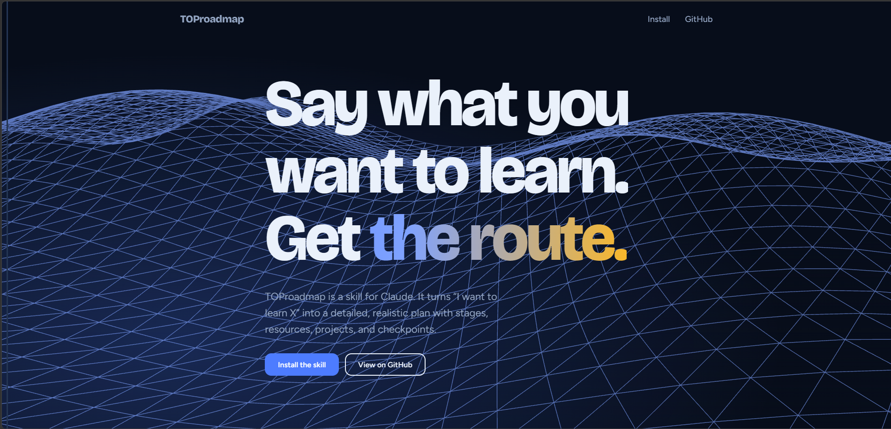

 <div align="center">

# TOProadmap

### Turn your goals into a clear direction.

**A Claude skill that transforms what you want to learn or achieve into a detailed, realistic, stage-by-stage roadmap.**

<br />

[](https://dalil2005.github.io/TOProadmap/)
[](https://claude.ai/)
[](LICENSE)

**[Explore the live website →](https://dalil2005.github.io/TOProadmap/)**

<br />

</div>

---

## Overview

TOProadmap is a Claude skill designed to turn learning goals, career ambitions, and practical objectives into structured, actionable roadmaps.

Instead of receiving generic advice or an overwhelming list of resources, you get a realistic plan that breaks your objective into manageable stages, with clear learning objectives, practical projects, milestones, and estimated timelines.

Whether you want to learn a programming language, develop a new career skill, start a fitness journey, or launch a business, TOProadmap helps you understand where to start, what to focus on, and what comes next.

**The idea is simple: less guessing, more direction, and real progress.**

## Live Website

<div align="center">

### Explore TOProadmap

[](https://dalil2005.github.io/TOProadmap/)

**[https://dalil2005.github.io/TOProadmap/](https://dalil2005.github.io/TOProadmap/)**

</div>

## Project Preview



*The TOProadmap landing page introduces the skill and provides access to its installation and documentation.*

## Key Features

| Feature | What you get |
|---|---|
| **Goal Understanding** | Transforms your objective into a clearly defined learning or action plan. |
| **Roadmap Overview** | Breaks your journey into 4–6 progressive stages with estimated durations. |
| **Detailed Learning Plans** | Provides objectives, topics, resources, practical projects, and milestones for every stage. |
| **First 7 Days** | Gives you a concrete starting plan so you can take action immediately. |
| **Progress Tracking** | Helps you measure progress and recover when you fall behind. |
| **Next Steps** | Identifies what to focus on after completing your roadmap. |
| **Customization** | Allows you to modify the skill's structure, tone, and planning rules. |

---

## How It Works

Every generated roadmap follows the same six-part structure.

### 01. Snapshot

Defines your objective, starting assumptions, estimated duration, and expected final outcome.

### 02. The Big Picture

Provides an overview of the entire journey, divided into 4–6 stages with realistic time estimates.

### 03. Stage-by-Stage Plan

Each stage includes:

- Learning objectives.
- Topics and concepts to understand.
- Recommended resources.
- Hands-on projects and practical exercises.
- Milestone checks to evaluate your progress.
- Common mistakes to avoid.

### 04. First 7 Days

A practical first-week schedule that tells you exactly what to do to get started.

### 05. Progress Tracking

Explains how to measure your progress, stay consistent, and adjust your schedule when you fall behind.

### 06. After the Roadmap

Suggests the next steps and directions to continue developing your skills.

For a complete example, see [`examples/example-roadmap.md`](examples/example-roadmap.md).

---

## Installation

### Claude App

1. Download [`dist/toproadmap.skill`](dist/toproadmap.skill) from this repository.
2. Open **Settings → Capabilities → Skills** in Claude.
3. Select **Upload skill**.
4. Choose the downloaded `toproadmap.skill` file.
5. Enable TOProadmap.

> **Requirements:** Code execution and file creation must be enabled. Menu names may change between Claude versions.

### Claude Code

Clone the repository directly into your Claude skills directory:

```bash
git clone https://github.com/dalil2005/toproadmap.git ~/.claude/skills/toproadmap
```

For a single project, clone it inside the project's `.claude/skills/` directory:

```bash
git clone https://github.com/dalil2005/toproadmap.git .claude/skills/toproadmap
```

Restart Claude Code afterwards.

---

## Getting Started

No special commands or complicated configuration are required.

Simply describe what you want to learn or achieve.

### Example Prompts

**Learn a new programming language**

```text
I want to learn Python from zero.
I have 6 hours available per week.
Create a realistic roadmap for me.
```

**Build a professional career**

```text
Give me a roadmap to become a UX designer
in 8 months, starting from the basics.
```

**Improve your fitness**

```text
I want to start running and eventually
complete my first 10K.
Create a progressive training roadmap.
```

**Launch a business**

```text
TOProadmap: Help me launch an online store
with a small budget.
Break everything into realistic stages.
```

You don't need to follow a specific prompt format. Just explain your goal, your current level, and any constraints that matter.

---

## Customization

TOProadmap is built around a straightforward Markdown instruction file.

The `SKILL.md` file contains the core instructions that control how the skill generates roadmaps.

You can customize:

- Roadmap structure and organization.
- Writing style and level of detail.
- Planning rules and recommendations.
- Learning stages and milestone requirements.

Edit the file to adapt TOProadmap to your own planning and learning preferences.

---

## Project Structure

```text
TOProadmap/
│
├── SKILL.md                    # Core skill instructions
│
├── dist/
│   └── toproadmap.skill        # Ready-to-upload skill package
│
├── docs/                       # GitHub Pages website
│
├── examples/
│   └── example-roadmap.md      # Sample generated roadmap
│
├── assets/
│   └── image.png               # Website preview
│
└── LICENSE                     # MIT License
```

---


**Live website:** [dalil2005.github.io/TOProadmap](https://dalil2005.github.io/TOProadmap/)

---

## License

TOProadmap is distributed under the [MIT License](LICENSE).

Copyright (c) 2026 Kaddour Cherif Zakaria Dalil.

You are free to use, modify, distribute, and build upon this project under the terms of the MIT License.

---

<div align="center">

### Start with a goal. Leave with a plan.

**TOProadmap — Less guessing. More direction. Real progress.**

<br />

[](https://dalil2005.github.io/TOProadmap/)
[](https://github.com/dalil2005/toproadmap)

<br />

Created by **[Kaddour Cherif Zakaria Dalil](https://github.com/dalil2005)**

</div>